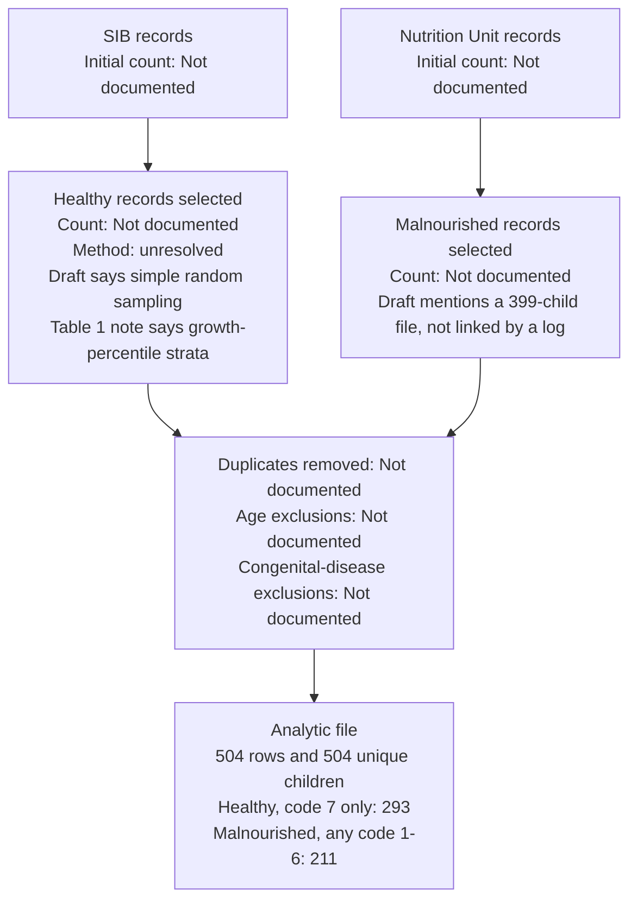

# Participant flow

Only counts that are present in the analytic file are filled. Intermediate counts are not invented.

Counts that appear in other project files and are not flow steps: 380 and 359 planned, 282 and 316 in an earlier draft, 598 rows in a working file with duplicate identifiers.

The analytic file has one row per national identifier, so the final unit is the child.
